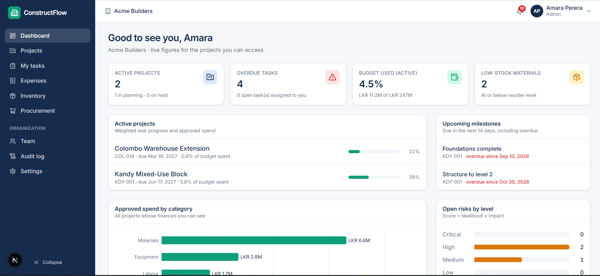
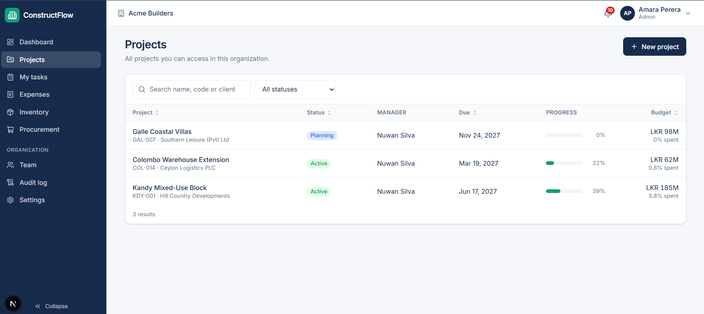

# ConstructFlow

ConstructFlow is a multi-tenant web app for running construction projects. It is built for small and medium construction companies that currently track their work in spreadsheets, chat groups, and paper delivery notes.

It covers the full flow of a project in one place: who is on it, what tasks are due, how much has been spent against the budget, what material is in stock, what was ordered and received, and what risks and safety incidents have come up. Every important action is permission-checked and recorded in an audit log.

## Screenshots

**Dashboard.** Active projects, overdue tasks, budget used, low-stock materials, upcoming milestones, spend by category, and open risks.



**Projects.** Every project you can access, with its status, manager, due date, progress, and budget spent. You can search and filter by status.



## Features

| Area | What it does |
|---|---|
| **Auth & organizations** | Register an organization, invite members, log in with JWT access tokens and rotating refresh cookies. Includes account lockout and login rate limiting. |
| **Projects** | Projects with a status lifecycle (enforced transitions), per-project members and project roles. |
| **Tasks & milestones** | Tasks with priority and a status workflow, milestones, daily site reports, and a scheduled job for deadline reminders. |
| **Finance** | Budget categories, budget allocations per project, and expenses that go through an approval workflow. Money uses `BigDecimal`; approved records are corrected with reversals, not edits. |
| **Inventory** | Materials with units and a stock movement ledger (receipts and issues to sites). Row locking prevents overselling stock. |
| **Procurement** | Suppliers, purchase orders, and goods receiving. Receiving posts stock to inventory and is idempotent, so a delivery can't be booked twice. |
| **Documents** | Project documents with version history, file-type checks, and local file storage. |
| **Risks & safety** | Risk register and safety incident reporting per project. |
| **Notifications** | In-app notifications, for example for approvals and deadlines. |
| **Reports & dashboard** | Project reports and a dashboard with spend-by-category charts. |
| **Audit log** | Records role changes, approvals, and other sensitive actions. |

### Roles

Each user has a role per organization: `ADMIN`, `PROJECT_MANAGER`, `SITE_ENGINEER`, `FINANCE_OFFICER`, `STOREKEEPER`, or `VIEWER`. The permissions for each role are defined in [RolePermissions.java](constructflow-backend/src/main/java/com/constructflow/security/RolePermissions.java).

## Tech stack

**Backend** ([constructflow-backend/](constructflow-backend/))
- Java 17, Spring Boot 4 (Web MVC, Security, OAuth2 resource server, Data JPA, Validation, Actuator)
- PostgreSQL 18 with Flyway migrations
- springdoc-openapi (Swagger UI)
- JUnit and Testcontainers for tests

**Frontend** ([constructflow-frontend/](constructflow-frontend/))
- Next.js 16 (App Router) and React 19 with the React Compiler
- Tailwind CSS 4
- TanStack Query and TanStack Table, React Hook Form with Zod, Recharts, Sonner
- Vitest and Testing Library for unit tests, Playwright for end-to-end tests

## Architecture

```
Browser ──► Next.js (:3000) ──/api/v1/** rewrite──► Spring Boot API (:8080) ──► PostgreSQL (:5434)
```

- **Modular monolith.** The backend is split by feature (`project`, `task`, `finance`, `inventory`, `procurement`, and so on). Each feature has its own `controller → service → repository` layers.
- **Same-origin proxy.** The browser only talks to the Next.js server, which forwards `/api/v1/**` to the backend. This keeps the refresh-token cookie first-party, so production needs no CORS.
- **Shared-schema multi-tenancy.** All organizations share one database. Every query is scoped to the current organization in the application layer.
- **Schema owned by Flyway.** Hibernate only validates that entities match the schema. Migrations live in [db/migration](constructflow-backend/src/main/resources/db/migration/).

The design is written up in more detail in [docs/00-blueprint.md](docs/00-blueprint.md), and the key decisions are recorded as ADRs in [docs/adr/](docs/adr/).

## Project structure

```
construction/
├── constructflow-backend/     Spring Boot API
│   └── src/main/java/com/constructflow/
│       ├── auth/  organization/  user/  security/
│       ├── project/  task/  finance/  inventory/  procurement/
│       ├── document/  risk/  safety/  notification/  report/  audit/
│       ├── common/            shared exceptions, base entities, paging
│       └── config/            app config and the dev data seeder
├── constructflow-frontend/    Next.js app
│   └── src/
│       ├── app/               routes: (auth) pages and (dashboard) pages
│       ├── features/          feature-specific forms, dialogs, and views
│       ├── components/        shared UI and layout
│       └── lib/               API client, hooks, constants, utils
├── docs/                      blueprint and ADRs
└── docker-compose.yml         local PostgreSQL (plus optional app containers)
```

## Getting started

### Prerequisites

- JDK 17 or later
- Node.js and npm
- Docker Desktop (for PostgreSQL and for the backend's Testcontainers tests)

### 1. Configure the environment

```bash
cp .env.example .env
```

Set `JWT_SECRET` to a random value of at least 32 bytes, for example the output of `openssl rand -base64 48`. The `local` profile has a development-only fallback secret, so this step is optional for local development.

### 2. Start the database

```bash
docker compose up -d postgres
```

PostgreSQL is exposed on host port **5434** so it doesn't clash with a locally installed PostgreSQL.

### 3. Run the backend

```bash
cd constructflow-backend
./mvnw spring-boot:run -Dspring-boot.run.profiles=local
```

On Windows PowerShell:

```powershell
.\mvnw.cmd spring-boot:run "-Dspring-boot.run.profiles=local"
```

The API runs at http://localhost:8080. Swagger UI is at http://localhost:8080/swagger-ui.html.

### 4. Run the frontend

```bash
cd constructflow-frontend
npm install
npm run dev
```

Open http://localhost:3000.

### Demo accounts

When the `local` profile starts against an empty database, it seeds demo data. All demo accounts use the password `ConstructFlow#2026`.

| Email | Role |
|---|---|
| `admin@acme.test` | Admin |
| `pm@acme.test` | Project manager |
| `engineer@acme.test` | Site engineer |
| `finance@acme.test` | Finance officer |
| `store@acme.test` | Storekeeper |
| `viewer@acme.test` | Viewer |
| `admin@lanka.test` | Admin of a second organization (useful for checking tenant isolation) |

The seeder is for local development only and must never be enabled in production.

## Configuration

The backend reads its secrets and settings from environment variables:

| Variable | Default | Purpose |
|---|---|---|
| `DB_URL` | `jdbc:postgresql://localhost:5434/constructflow` | Database connection URL |
| `DB_USERNAME` / `DB_PASSWORD` | `constructflow` | Database credentials |
| `JWT_SECRET` | none (a dev fallback is used in `local`) | HS256 signing key, at least 32 bytes |
| `ALLOWED_ORIGINS` | `http://localhost:3000` | Origins allowed to call the auth endpoints |
| `AUTH_COOKIE_SECURE` | `true` (`false` in `local`) | Marks the refresh cookie as `Secure` |
| `STORAGE_LOCAL_ROOT` | `./data/uploads` | Where uploaded documents are stored |
| `SPRING_PROFILES_ACTIVE` | none | `local` for development, `prod` for production |

The frontend reads `BACKEND_URL` (default `http://localhost:8080`). This variable is server-only and is never sent to the browser.

## Testing

**Backend.** These tests include integration tests that start PostgreSQL with Testcontainers, so Docker must be running.

```bash
cd constructflow-backend
./mvnw test
```

**Frontend unit tests and lint**

```bash
cd constructflow-frontend
npm test
npm run lint
```

**End-to-end tests.** These run against the real stack with the seeded demo data.

```bash
docker compose up -d postgres
# in constructflow-backend:
./mvnw spring-boot:run -Dspring-boot.run.profiles=local
# in constructflow-frontend:
npm run build
npm run test:e2e
```

## Documentation

- [docs/00-blueprint.md](docs/00-blueprint.md): scope, user stories, data model, permission matrix, business rules, API design, and the security and testing strategy
- [docs/adr/](docs/adr/): architecture decision records
