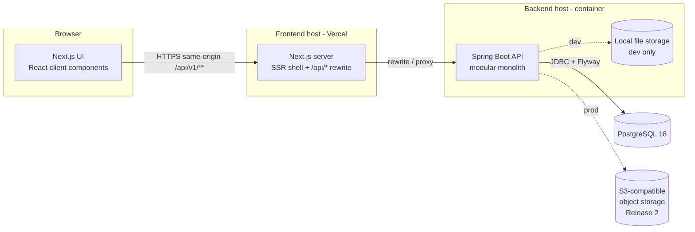
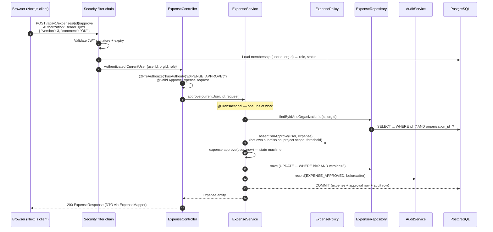
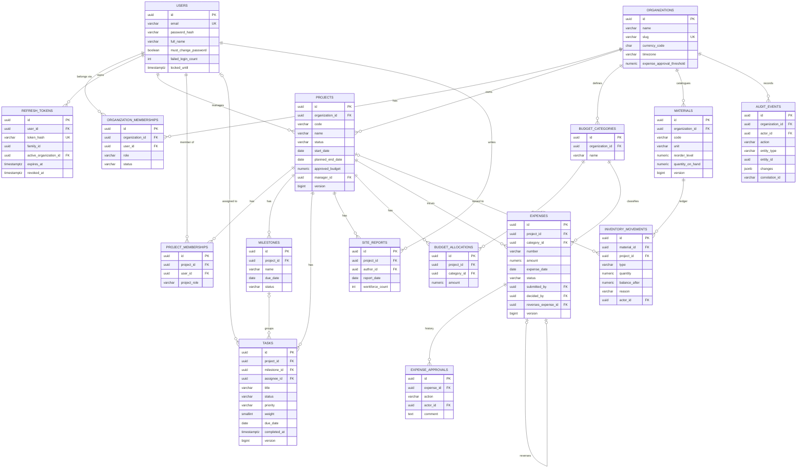
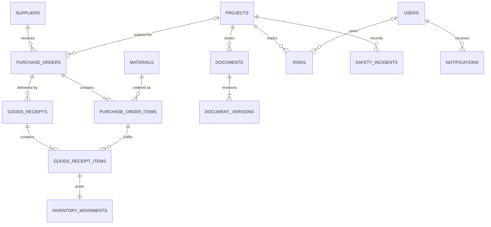
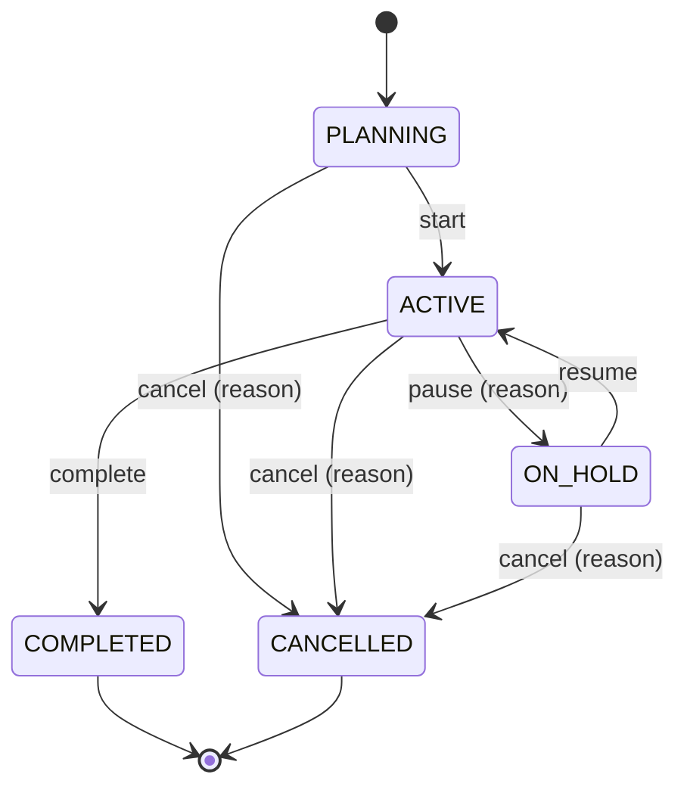

# ConstructFlow — Phase 0 Blueprint

> Status: **Draft for review** · Date: 2026-10-20 · Phase: 0 (Requirements & Architecture)
>
> This document is the design baseline for every later phase. Anything not written here is
> not yet decided. When implementation diverges from it, this document (or an ADR) is updated
> in the same commit.

Contents

1. [Product scope and MVP boundaries](#1-product-scope-and-mvp-boundaries)
2. [User stories and acceptance criteria](#2-user-stories-and-acceptance-criteria)
3. [System architecture](#3-system-architecture)
4. [MVC request flow](#4-mvc-request-flow)
5. [Backend folder structure](#5-backend-folder-structure)
6. [Frontend folder structure](#6-frontend-folder-structure)
7. [Database entities and relationships](#7-database-entities-and-relationships)
8. [ER diagrams](#8-er-diagrams)
9. [Organization model and role-permission matrix](#9-organization-model-and-role-permission-matrix)
10. [Screens and navigation](#10-screens-and-navigation)
11. [Business rules](#11-business-rules)
12. [MVP API design](#12-mvp-api-design)
13. [Security strategy](#13-security-strategy)
14. [Testing strategy](#14-testing-strategy)
15. [Development milestones](#15-development-milestones)
16. [Initial setup commands](#16-initial-setup-commands)
17. [Trade-offs and assumptions](#17-trade-offs-and-assumptions)

Architecture Decision Records live in [`docs/adr/`](adr/).

---

## 1. Product scope and MVP boundaries

### 1.1 Problem statement

Small and medium construction companies (10–200 staff, 2–20 concurrent sites) typically run
projects across spreadsheets, WhatsApp groups, paper delivery notes and accounting software
that knows nothing about sites. The consequences are concrete:

- Nobody can answer "how far along is project X and how much have we spent?" without a meeting.
- Expenses are approved informally, so budget overruns are discovered late.
- Stock "disappears" because issues to sites are not recorded consistently.
- Deliveries get booked twice (or never), so stock and supplier balances drift.

ConstructFlow puts those operations into one multi-tenant system with enforced workflows,
permissions and an audit trail.

### 1.2 Release scope

The MVP is deliberately the smallest set that demonstrates **every important engineering
skill**: authentication, multi-tenancy, authorization, state machines, money, concurrency and
auditing. Later releases reuse those patterns rather than introduce new ones.

| Release | Modules | Why in this release |
|---|---|---|
| **MVP (Phases 1–5)** | Auth & sessions · Organizations & team · Projects · Project members · Tasks & milestones · Site daily reports · Budgets & expenses · Materials & inventory · Audit log (core) · Basic dashboard | Covers security, tenancy, state machines, financial correctness, concurrency. Audit is pulled forward from Phase 7 because role changes and financial approvals must be audited the moment they exist. |
| **Release 2 (Phase 6)** | Suppliers · Purchase orders · Goods receiving · Documents & revisions | Builds on inventory (receiving posts stock) and adds idempotency and file security. |
| **Release 3 (Phases 7–8)** | Risks · Safety incidents · Notifications · Reports & analytics | Mostly CRUD + aggregation on top of existing data. |
| **Optional (after Phase 9)** | AI-assisted project report draft | Only once the core is stable; must go through permission-checked services. |

### 1.3 Explicitly deferred (not in any planned phase unless approved)

| Deferred item | Reason | MVP substitute |
|---|---|---|
| Email invitations / password reset by email | Needs email provider, templates, deliverability | Admin creates member with a one-time temporary password; user must change it on first login |
| Multiple warehouses / stock locations | Multiplies inventory complexity | One store per organization; issues go to projects |
| Multi-currency | Exchange rates, rounding rules | One currency per organization (ISO 4217 code in settings, default `LKR`) |
| Custom roles | Needs a permission-editor UI and data model | Six fixed roles mapped to a fixed permission set in code |
| Drag-and-drop task board | UX nicety, not engineering signal | Board view with a status menu per card |
| Task dependency graph with scheduling (Gantt / critical path) | Large algorithmic scope | Optional simple "blocked by" link in Phase 4 if time permits |
| Real-time push (WebSockets/SSE) | Infrastructure for little gain | Notification count polled every 60 s |
| Offline mobile app | Separate product | Responsive web UI |
| Postgres row-level security | Defense-in-depth, but complicates pooling & tests | Application-level tenant scoping + tests (see ADR-0003) |

### 1.4 Non-functional targets (portfolio-realistic)

- p95 API latency < 300 ms for list endpoints on seed data (≈ 50 projects, 5k tasks, 20k movements).
- All list endpoints paginated (default 20, max 100).
- WCAG 2.1 AA colour contrast, full keyboard navigation for core flows.
- Works on 360 px wide screens and up.
- Single backend instance assumed (affects rate limiting and scheduled jobs; documented).

---

## 2. User stories and acceptance criteria

Format: **ID — As a _role_, I want _goal_, so that _value_.** Acceptance criteria (AC) are
written so each can become an automated test. IDs are referenced from tests and commits.

### Epic AUTH — Authentication and organizations

**AUTH-1** — As a company owner, I want to register my organization and become its
administrator, so that my team can start using ConstructFlow.
- AC1: Submitting organization name, my name, email and a password (≥ 12 chars) creates the
  organization, my user and an `ADMIN` membership in one transaction.
- AC2: An email already registered returns `409` without revealing other account details.
- AC3: I am logged in afterwards (access token + refresh cookie issued).

**AUTH-2** — As a user, I want to log in with email and password.
- AC1: Valid credentials return a 15-minute access token and set an HttpOnly refresh cookie.
- AC2: Invalid credentials return `401` with a generic message (no "user not found" vs "wrong password" distinction).
- AC3: After 5 consecutive failures the account is locked for 15 minutes; per-IP rate limit returns `429`.
- AC4: A user with `must_change_password` is redirected to change it before using the app.

**AUTH-3** — As a user, I want my session to stay alive while I work and end when I log out.
- AC1: An expired access token is transparently refreshed once using the refresh cookie.
- AC2: Each refresh rotates the refresh token; re-using an old refresh token revokes the whole session family.
- AC3: Logout revokes the refresh token family and clears the cookie; the old refresh token no longer works.

**AUTH-4** — As a user who belongs to several organizations, I want to switch the active organization.
- AC1: I can only switch to organizations where my membership is `ACTIVE`.
- AC2: After switching, every list shows only that organization's data.

**ORG-1** — As an admin, I want to add team members and assign roles.
- AC1: Admin creates a member (name, email, role, temporary password). Non-admins get `403`.
- AC2: The last active admin of an organization cannot be demoted or disabled (`409`).
- AC3: Role changes and member disabling are written to the audit log with before/after role.
- AC4: A disabled member's next API request fails with `401` even if their access token has not expired.

### Epic PRJ — Projects

**PRJ-1** — As a project manager, I want to create a project with code, client, site, dates and budget.
- AC1: Project code is unique per organization (`409` on duplicate).
- AC2: Planned completion date must be on or after start date; budget ≥ 0 with 2 decimal places.
- AC3: New projects start in `PLANNING`; the creator is added as the project's manager member.

**PRJ-2** — As a project manager, I want to move a project through its lifecycle.
- AC1: Only transitions in §11.1 are accepted; others return `409` with the allowed transitions.
- AC2: `COMPLETED` is rejected while open tasks or submitted (pending) expenses exist.
- AC3: `CANCELLED` requires a reason; completed/cancelled projects become read-only.

**PRJ-3** — As any member, I want a project list I can search, filter by status and sort.
- AC1: I see only projects I'm allowed to see (§9.3).
- AC2: Each row shows code, name, status, manager, progress %, budget utilization %.

**PRJ-4** — As a project manager, I want to add or remove project members.
- AC1: Only active organization members can be added.
- AC2: Removing a member who still has open assigned tasks is rejected with the task count.

### Epic TSK — Tasks, milestones, site reports

**TSK-1** — As a project manager, I want to create and assign tasks with priority and dates.
- AC1: Assignee must be a member of the project.
- AC2: Due date ≥ start date when both are given.
- AC3: The assignee receives an in-app notification (Release 3; event is recorded from Phase 4).

**TSK-2** — As a site engineer, I want to update the status of tasks assigned to me.
- AC1: I can only transition tasks assigned to me; transitions follow §11.2.
- AC2: Moving to `DONE` sets `completed_at`; reopening clears it.
- AC3: A stale `version` returns `409` instead of overwriting someone else's change.

**TSK-3** — As a project manager, I want to see overdue tasks.
- AC1: A task is overdue when `due_date` < today (organization timezone) and status ∉ {`DONE`, `CANCELLED`}.
- AC2: Overdue is computed at query time, never stored.

**TSK-4** — As a project manager, I want milestones that show progress from their tasks.
- AC1: Milestone progress = weighted share of its tasks that are `DONE` (§11.3).

**TSK-5** — As a site engineer, I want to submit a daily site report.
- AC1: One report per project per date per author; fields: weather, workforce count, work performed, issues.
- AC2: Reports are immutable after 24 hours (corrections are added as a new note).

### Epic FIN — Budgets and expenses

**FIN-1** — As a project manager, I want to allocate the project budget across categories.
- AC1: Sum of category allocations ≤ project approved budget.

**FIN-2** — As a site engineer or finance officer, I want to record an expense and submit it.
- AC1: Draft expenses can be edited or deleted by their creator; submitted ones cannot.
- AC2: Amount > 0, two decimal places, expense date not in the future, category required.
- AC3: Expenses cannot be added to `COMPLETED` or `CANCELLED` projects.

**FIN-3** — As a finance officer, I want to approve or reject submitted expenses.
- AC1: I cannot approve or reject an expense I submitted (`403`, segregation of duties).
- AC2: Rejection requires a comment.
- AC3: Approval updates status, writes an `expense_approvals` row and an audit event in one transaction; any failure rolls back all three.
- AC4: Two approvers acting simultaneously → exactly one succeeds, the other receives `409`.

**FIN-4** — As a finance officer, I want to correct an approved expense without editing it.
- AC1: I create a **reversal** linked to the original (negative amount equal to the original), which itself goes through approval.
- AC2: An expense can be reversed at most once.

**FIN-5** — As a project manager, I want a financial summary per project.
- AC1: Shows budget, approved spend, pending spend, remaining, utilization %, variance per category (§11.4).

### Epic INV — Materials and inventory

**INV-1** — As a storekeeper, I want a material catalogue (code, name, unit, reorder level).
- AC1: Material code unique per organization; unit from a fixed list (`BAG`, `KG`, `TONNE`, `M`, `M2`, `M3`, `LITRE`, `PIECE`, ...).

**INV-2** — As a storekeeper, I want to record receipts, issues to projects and adjustments.
- AC1: Every change writes one `inventory_movements` row (type, signed quantity, balance after, actor, reason, reference).
- AC2: An issue larger than stock on hand returns `409`; stock never goes negative.
- AC3: Adjustments require a reason.

**INV-3** — As the business, I want concurrent issues to never oversell stock.
- AC1: With stock 10, ten parallel requests to issue 2 each → exactly 5 succeed, 5 get `409`, final stock 0, ledger sum = 0.

**INV-4** — As a storekeeper, I want to see low-stock materials and the movement history.
- AC1: Low stock = quantity on hand ≤ reorder level.

### Epic AUD — Audit

**AUD-1** — As an admin, I want an audit trail of important changes.
- AC1: Events listed in §11.7 produce an audit row with actor, org, project, action, entity, correlation ID and safe change summary.
- AC2: No API exists to update or delete audit events; a database trigger rejects `UPDATE`/`DELETE`.
- AC3: Audit rows never contain passwords, tokens or secrets.

### Epic DSH — Dashboard

**DSH-1** — As any user, I want a dashboard with real metrics for my visible projects.
- AC1: Active projects, overdue tasks, budget utilization, low-stock count, upcoming milestones (14 days).
- AC2: All numbers come from the API and respect my permissions.

Release 2/3 stories (procurement, documents, risks, safety, notifications, reports) are
written at the start of their phase using the same format; their key rules are already fixed in §11.

---

## 3. System architecture

### 3.1 Style: modular monolith, two deployables



- **One Spring Boot application** organized by feature package (`project`, `task`, `finance`, ...).
  Modules talk to each other through **service classes**, never through each other's repositories.
  This keeps the option to extract a module later without paying microservice costs now (ADR-0001).
- **One Next.js application** that renders the UI and proxies `/api/v1/**` to the backend so the
  browser sees a **single origin**. That makes the refresh-token cookie first-party and removes
  production CORS entirely (ADR-0002).
- **One PostgreSQL database**, shared by all tenants, every tenant-owned row carries
  `organization_id` (ADR-0003).

### 3.2 Technology versions (to be pinned exactly in Phase 1)

| Area | Choice | Notes |
|---|---|---|
| JDK | **Java 21 LTS** (Temurin) | Only JDK 17 is installed locally; see §16 step 0. Java 17 is an acceptable fallback (Spring Boot 4 baseline). |
| Backend framework | Spring Boot **4.x** (latest GA at Phase 1) | Brings Spring Framework 7, Spring Security 7, Hibernate 7, Jackson 3. |
| Build | Maven via wrapper (`mvnw`) | |
| Database | PostgreSQL **18** | Docker image `postgres:18-alpine`. |
| Migrations | Flyway (`flyway-core` + `flyway-database-postgresql`) | |
| API docs | springdoc-openapi (version line matching Spring Boot 4) | |
| Tests | JUnit 5, Mockito, Spring Boot Test, Testcontainers (PostgreSQL) | Docker is installed locally. |
| Frontend | Next.js **16** (App Router), React 19, **JavaScript** | |
| Styling | Tailwind CSS **4** (CSS-first `@theme` tokens) | No `tailwind.config.js` needed; tokens live in `globals.css`. |
| Forms | React Hook Form + Zod + `@hookform/resolvers` | |
| Server state | TanStack Query | Added beyond the mandated list. Justification in ADR-0007. |
| Tables / charts / icons / toasts | TanStack Table · Recharts · Lucide React · Sonner | |
| HTTP client | Small `fetch` wrapper (no Axios) | No dependency; works in server and client code. |
| Frontend tests | Vitest + React Testing Library · Playwright | |
| Runtime | Node 22 LTS (installed: 22.15.1) | |

Exact versions are recorded in `docs/versions.md` during Phase 1, after confirming they resolve
and build together. I will not guess patch versions in this document.

---

## 4. MVC request flow

Worked example: a finance officer approves an expense.



What each layer owns:

| Layer | Owns | Must not |
|---|---|---|
| **Security filters** | Who are you? Is the token valid? Is your membership active? | Business decisions |
| **Controller** | URL, HTTP verb, `@Valid` on DTOs, coarse permission (`@PreAuthorize`), status code, DTO mapping | Touch repositories, contain `if` business rules |
| **Service** | Business rules, transaction boundary, resource-level authorization (project scope, segregation of duties), orchestration across repositories and other services | Know about HTTP (`HttpServletRequest`, status codes) |
| **Policy / domain methods** | Pure, unit-testable rules (`expense.approve()`, `ProjectStatus.canTransitionTo()`) | I/O |
| **Repository** | SQL: lookups, pagination, aggregation, locking | Business decisions |
| **Entity** | Persistent state, invariants that only need the entity's own fields | Leave the backend (never serialized to JSON) |
| **DTO / Mapper** | The public API contract; converting entity ↔ DTO | Business logic |
| **`@RestControllerAdvice`** | Turning exceptions into RFC 9457 Problem Details | Leak stack traces, SQL, class names |

Error outcomes in the example: wrong org → `404` (not `403`, to avoid confirming existence);
own submission → `403`; already approved → `409`; stale `version` → `409`; validation → `400`
with field errors.

---

## 5. Backend folder structure

Repository layout (monorepo — one Git repo, two apps):

```text
D:\construction\
├── constructflow-backend/
├── constructflow-frontend/
├── docs/                       # blueprint, ADRs, data dictionary, API examples, threat model
├── docker-compose.yml          # postgres (+ backend/frontend profiles later)
├── .github/workflows/ci.yml
├── .gitignore
└── README.md
```

Backend (packages are created only when the phase that needs them starts):

```text
constructflow-backend/
├── src/main/java/com/constructflow/
│   ├── ConstructFlowApplication.java
│   ├── config/                    # SecurityConfig, OpenApiConfig, JpaConfig, ClockConfig, CorsConfig (dev only)
│   ├── common/
│   │   ├── exception/             # DomainException hierarchy, GlobalExceptionHandler (@RestControllerAdvice)
│   │   ├── response/              # PageResponse<T>
│   │   ├── web/                   # CorrelationIdFilter, IdempotencyKey support
│   │   ├── persistence/           # BaseEntity (id, createdAt, updatedAt, version), OrgSequenceService
│   │   └── money/                 # Money helpers (BigDecimal scale/rounding rules)
│   ├── security/                  # JwtService, CurrentUser, MembershipAuthenticationConverter,
│   │                              # Permission enum, RolePermissions, LoginRateLimiter
│   ├── auth/                      # AuthController, AuthService, RefreshToken entity/repo, cookie handling
│   ├── organization/              # Organization, OrganizationMembership, MemberController/Service
│   ├── user/                      # User entity, UserRepository, profile/password change
│   ├── project/
│   │   ├── controller/  ProjectController, ProjectMemberController
│   │   ├── service/     ProjectService, ProjectAccessPolicy, ProjectProgressService
│   │   ├── repository/  ProjectRepository, ProjectMembershipRepository
│   │   ├── entity/      Project, ProjectStatus, ProjectMembership
│   │   ├── dto/         CreateProjectRequest, UpdateProjectRequest, ProjectResponse, ProjectSummaryResponse, TransitionProjectRequest
│   │   ├── mapper/      ProjectMapper
│   │   └── exception/   ProjectNotFoundException, InvalidProjectTransitionException
│   ├── task/                      # Task, TaskStatus, Milestone, SiteReport (+ same layer split)
│   ├── finance/                   # BudgetCategory, BudgetAllocation, Expense, ExpenseApproval, ExpensePolicy
│   ├── inventory/                 # Material, InventoryMovement, InventoryService
│   ├── audit/                     # AuditEvent, AuditService, AuditController (read-only)
│   ├── dashboard/                 # DashboardController/Service (read-only aggregation queries)
│   │   ── Release 2+ ──
│   ├── procurement/  document/  risk/  safety/  notification/  report/
└── src/main/resources/
    ├── application.yml            # shared defaults, no secrets
    ├── application-local.yml      # local dev (docker-compose DB)
    ├── application-prod.yml       # prod: everything from env vars
    └── db/migration/              # V1__baseline.sql, V2__auth_and_orgs.sql, ...
src/test/java/com/constructflow/
    ├── support/                   # PostgresTestContainer, TestDataFactory, AuthTestHelper
    ├── auth/ project/ task/ finance/ inventory/ security/ audit/
```

Conventions:
- Constructor injection only (`final` fields, no `@Autowired` on fields).
- Java `record`s for DTOs; entities are classes (JPA needs a no-arg constructor and mutability).
- `spring.jpa.open-in-view=false` so lazy-loading cannot silently run SQL in the web layer.
- `spring.jpa.hibernate.ddl-auto=validate` everywhere: Flyway creates the schema and Hibernate only checks it.
- An injected `Clock` (not `Instant.now()`) so time-based rules (overdue, 24-hour lock) are testable.

---

## 6. Frontend folder structure

```text
constructflow-frontend/
├── src/
│   ├── app/
│   │   ├── layout.js                      # fonts, <Providers>, Toaster
│   │   ├── globals.css                    # design tokens (:root vars + @theme)
│   │   ├── page.js                        # redirects to /dashboard or /login
│   │   ├── not-found.js
│   │   ├── (auth)/
│   │   │   ├── layout.js                  # centered auth layout
│   │   │   ├── login/page.js
│   │   │   ├── register/page.js
│   │   │   └── change-password/page.js
│   │   └── (dashboard)/
│   │       ├── layout.js                  # AppShell: sidebar, topbar, auth guard
│   │       ├── error.js / loading.js
│   │       ├── dashboard/page.js
│   │       ├── projects/page.js
│   │       ├── projects/new/page.js
│   │       ├── projects/[projectId]/      # layout.js (tabs) + page.js (overview)
│   │       │   ├── tasks/page.js  milestones/page.js  site-reports/page.js
│   │       │   ├── finance/page.js  members/page.js
│   │       ├── tasks/page.js              # "My tasks" across projects
│   │       ├── finance/expenses/page.js   # approval queue
│   │       ├── inventory/page.js  inventory/[materialId]/page.js
│   │       ├── team/page.js  audit/page.js  settings/page.js
│   │       └── (Release 2+) procurement/ documents/ risks/ safety/ reports/
│   ├── components/
│   │   ├── ui/          Button, Input, Select, Textarea, Checkbox, Dialog, DropdownMenu, Badge,
│   │   │                DataTable, Pagination, SearchField, DatePicker, Tabs, Skeleton
│   │   ├── layout/      AppShell, Sidebar, Topbar, MobileNav, OrgSwitcher, Breadcrumbs, PageHeader, UserMenu
│   │   ├── forms/       FormField (label + control + error), MoneyInput, QuantityInput
│   │   └── feedback/    EmptyState, ErrorState, LoadingSkeleton, ConfirmDialog, StatCard, StatusBadge
│   ├── features/
│   │   ├── auth/        AuthProvider (in-memory access token), useAuth, LoginForm, schemas.js
│   │   ├── projects/    api.js, hooks.js (useProjects...), ProjectForm, ProjectTable, schemas.js
│   │   ├── tasks/  finance/  inventory/  team/  audit/  dashboard/
│   ├── lib/
│   │   ├── api/         client.js (fetch wrapper, refresh-once, Problem Details parsing), errors.js
│   │   ├── auth/        permissions.js (mirror of role → permission for UI only)
│   │   ├── utils/       format.js (currency, number, date), cn.js
│   │   └── constants/   statuses.js, routes.js
│   └── hooks/           useDebounce, useMediaQuery
├── e2e/                 # Playwright specs
├── .env.example         # BACKEND_URL (server-only), NEXT_PUBLIC_APP_NAME
└── next.config.mjs      # rewrites /api/v1/:path* → ${BACKEND_URL}/api/v1/:path*
```

Rendering approach: the authenticated area depends on an access token that lives only in browser memory,
so **data-fetching pages are Client Components** using TanStack Query. Server Components are used for
layouts, static shells, the auth pages' outer layout and metadata. This is a deliberate trade-off (ADR-0002):
it avoids forwarding tokens through the Next.js server, at the cost of not server-rendering private data.

### Design tokens (Phase 2)

Defined once in `globals.css` and exposed to Tailwind 4 through `@theme`, so components write
`bg-primary`, `text-muted`, `border-border` instead of hex values:

| Token | Value | Usage |
|---|---|---|
| `--color-primary` | `#172B4D` | Sidebar, primary buttons, headings |
| `--color-secondary` | `#0F9F78` | Accents, progress, positive CTAs |
| `--color-background` | `#F5F7FA` | App background |
| `--color-surface` | `#FFFFFF` | Cards, tables, dialogs |
| `--color-text` | `#172B4D` | Primary text |
| `--color-muted` | `#64748B` | Secondary text |
| `--color-border` | `#E2E8F0` | Borders, dividers |
| `--color-success / warning / danger / info` | `#16A34A / #D97706 / #DC2626 / #2563EB` | Status badges, alerts |
| `--radius-sm / md / lg` | 6 / 8 / 12 px | Inputs / buttons / cards |
| Font | Inter (via `next/font`) | |

Status colour mapping is centralized in `StatusBadge` (e.g. `ACTIVE`→success, `ON_HOLD`→warning,
`CANCELLED`→danger, `PLANNING`→info) so the meaning of a colour is consistent everywhere.

---

## 7. Database entities and relationships

### 7.1 Conventions

| Concern | Decision |
|---|---|
| Primary keys | `uuid`, generated by the application as time-ordered UUIDv7 (good index locality, safe to expose, no enumeration). Fallback: random v4 if the Hibernate version lacks v7 support. |
| Human-readable numbers | `project.code` (user-entered, unique per org); `PO-000123`, `EXP-000045` from a per-org `org_sequences` counter row locked with `SELECT ... FOR UPDATE`. |
| Tenant column | Every tenant-owned table has `organization_id uuid not null` + FK, and composite indexes start with it. |
| Timestamps | `timestamptz`, stored UTC, Java `Instant`. Business dates (due date, expense date) are `date` / `LocalDate`. |
| Money | `numeric(15,2)`, Java `BigDecimal`, scale 2, `RoundingMode.HALF_EVEN`. Never `double`. |
| Quantities | `numeric(14,3)` (e.g. 2.5 m³ of concrete). |
| Optimistic locking | `version bigint not null default 0` on mutable aggregates (projects, tasks, milestones, expenses, materials, purchase orders). Clients send `version` with updates. |
| Enums | Stored as `varchar` + `CHECK (status IN (...))`. Readable in SQL and safe to extend via migration. |
| Deletes | `ON DELETE RESTRICT` by default. Business records with financial/audit meaning are never hard-deleted (projects are archived, members disabled, tasks cancelled). Only drafts (draft expenses, draft POs) may be hard-deleted. |
| Audit columns | `created_at`, `updated_at`, `created_by` where useful. The full change history lives in `audit_events`. |

### 7.2 MVP tables

| Table | Purpose | Key columns & constraints |
|---|---|---|
| `organizations` | Tenant | `name`, `slug` UNIQUE, `currency_code` char(3), `timezone` (default `Asia/Colombo`), `expense_approval_threshold` numeric(15,2) |
| `users` | Global identity (one per email) | `email` UNIQUE (stored lower-case), `password_hash`, `full_name`, `must_change_password`, `failed_login_count`, `locked_until`, `last_login_at` |
| `organization_memberships` | User ↔ org with role | `organization_id`, `user_id`, `role` CHECK, `status` (`ACTIVE`/`DISABLED`); UNIQUE(`organization_id`,`user_id`) |
| `refresh_tokens` | Revocable sessions | `user_id`, `token_hash` UNIQUE (SHA-256; raw token never stored), `family_id`, `active_organization_id`, `expires_at`, `family_expires_at`, `revoked_at`, `replaced_by_id`, `user_agent`, `ip` |
| `org_sequences` | Per-org counters | PK(`organization_id`,`name`), `next_value` |
| `projects` | Construction project | `organization_id`, `code` UNIQUE per org, `name`, `description`, `client_name`, `client_contact`, `site_address`, `start_date`, `planned_end_date` CHECK ≥ start, `actual_end_date`, `approved_budget` CHECK ≥ 0, `status` CHECK, `manager_id` → users, `cancel_reason`, `archived_at`, `version` |
| `project_memberships` | Who can see/work on a project | `project_id`, `user_id`, `organization_id`, `project_role` (`MANAGER`/`MEMBER`); UNIQUE(`project_id`,`user_id`) |
| `milestones` | Key dates | `project_id`, `name`, `due_date`, `status`, `completed_at`, `version` |
| `tasks` | Work items | `project_id`, `milestone_id` NULL, `title`, `description`, `assignee_id` NULL, `priority` CHECK, `status` CHECK, `weight` smallint 1–10 default 1, `start_date`, `due_date` CHECK ≥ start, `completed_at`, `version` |
| `site_reports` | Daily site diary | `project_id`, `author_id`, `report_date`, `weather`, `workforce_count` ≥ 0, `work_performed`, `issues`; UNIQUE(`project_id`,`author_id`,`report_date`) |
| `budget_categories` | Org-level cost categories | `organization_id`, `name` UNIQUE per org, `active` (seeded: Labour, Materials, Equipment, Subcontractors, Overheads) |
| `budget_allocations` | Project budget per category | `project_id`, `category_id`, `amount` ≥ 0; UNIQUE(`project_id`,`category_id`) |
| `expenses` | Cost record | `organization_id`, `project_id`, `category_id`, `number`, `description`, `amount` numeric(15,2) (negative only for reversals), `expense_date`, `vendor_name`, `status` CHECK, `submitted_by`, `submitted_at`, `decided_by`, `decided_at`, `reverses_expense_id` UNIQUE NULL → expenses, `version`; CHECK `decided_by <> submitted_by` |
| `expense_approvals` | Approval history (append-only) | `expense_id`, `action` (`SUBMITTED`/`APPROVED`/`REJECTED`), `actor_id`, `comment`, `created_at` |
| `materials` | Catalogue + stock balance | `organization_id`, `code` UNIQUE per org, `name`, `unit` CHECK, `reorder_level` ≥ 0, `quantity_on_hand` numeric(14,3) CHECK ≥ 0, `active`, `version` |
| `inventory_movements` | Stock ledger (append-only) | `organization_id`, `material_id`, `project_id` NULL, `type` (`RECEIPT`/`ISSUE`/`RETURN`/`ADJUSTMENT`), `quantity` signed numeric(14,3) ≠ 0, `balance_after` ≥ 0, `reason`, `reference_type`/`reference_id` (e.g. goods receipt), `actor_id`, `occurred_at` |
| `audit_events` | Append-only audit trail | `organization_id`, `project_id` NULL, `actor_id` NULL (system), `action`, `entity_type`, `entity_id`, `summary`, `changes` jsonb, `correlation_id`, `ip`, `created_at`; trigger blocks UPDATE/DELETE |

### 7.3 Release 2–3 tables (designed now, migrated in their phase)

| Table | Key points |
|---|---|
| `suppliers` | org-scoped, `name`, contact, `tax_id`, `active`; UNIQUE(org, name) |
| `purchase_orders` | `number`, `supplier_id`, `project_id` NULL (stock order) , `status`, `total_amount`, `created_by`, `submitted_by`, `approved_by` CHECK ≠ `created_by`, `version` |
| `purchase_order_items` | `material_id`, `quantity_ordered`, `quantity_received` ≤ ordered, `unit_price` numeric(15,4), `line_total` numeric(15,2) |
| `goods_receipts` | `purchase_order_id`, `received_by`, `delivery_note_ref`, `idempotency_key` — UNIQUE(`organization_id`,`idempotency_key`) and UNIQUE(`purchase_order_id`,`delivery_note_ref`) |
| `goods_receipt_items` | `purchase_order_item_id`, `quantity` > 0 → produces one `inventory_movements` RECEIPT each |
| `documents` | `project_id`, `title`, `category`, `current_version_no`, `created_by` |
| `document_versions` | `document_id`, `version_no` UNIQUE per document, `storage_key` (generated), `original_filename` (display only), `content_type`, `size_bytes`, `sha256`, `uploaded_by`, `uploaded_at` |
| `risks` | `project_id`, `title`, `likelihood` 1–5, `impact` 1–5, `score` GENERATED (`likelihood*impact`) STORED, `owner_id`, `mitigation`, `due_date`, `status`, `version` |
| `safety_incidents` | `project_id`, `occurred_at`, `location`, `severity`, `description`, `corrective_actions`, `reported_by`, `status`, `closed_at` |
| `notifications` | `organization_id`, `recipient_id`, `type`, `title`, `link`, `read_at`, `created_at`; index (`recipient_id`, `read_at`) |

### 7.4 Important indexes (driven by access patterns)

| Index | Serves |
|---|---|
| `projects (organization_id, status)` | Project list filtered by status |
| `project_memberships (user_id, project_id)` | "Projects I can see" |
| `tasks (project_id, status, due_date)` | Project task list, overdue query |
| `tasks (assignee_id, status)` | "My tasks" |
| `expenses (project_id, status)` | Financial summary aggregation |
| `expenses (organization_id, status, submitted_at)` | Approval queue |
| `inventory_movements (material_id, occurred_at desc)` | Movement history |
| `materials (organization_id) WHERE quantity_on_hand <= reorder_level` | Not indexable as-is (compares columns); low-stock is a filtered scan of a small table — acceptable |
| `audit_events (organization_id, created_at desc)`, `(entity_type, entity_id)` | Audit log browse / entity history |
| `refresh_tokens (family_id)` | Revoke family |

---

## 8. ER diagrams

### 8.1 MVP



(`organization_id` columns on child tables and `org_sequences` are omitted from the diagram for readability.)

### 8.2 Release 2–3 additions



---

## 9. Organization model and role-permission matrix

### 9.1 Tenancy model

- A **user** is global (one login per email). A **membership** links a user to an organization with exactly
  one role. A user may have memberships in several organizations, each with a different role.
- The access token carries `sub` (user ID) and `org` (active organization ID). **It does not carry the role.**
  On every request the backend loads the membership `(user, org)` and rejects the request if it is missing or
  `DISABLED`. Consequence: demoting or disabling someone takes effect on their next request, not 15 minutes later.
  Cost: one indexed primary-key-style lookup per request (acceptable; can be cached later).
- The **organization ID used by services always comes from the authenticated principal**, never from a
  request body, query string or path. A client cannot "ask for" another organization's data.
- Lookups use `findByIdAndOrganizationId(...)`. A resource that exists in another organization is reported
  as `404 Not Found`, identical to a resource that does not exist.

### 9.2 Permissions

Roles are coarse; code checks **permissions**, which keeps checks stable if roles change. Role → permission
mapping is a static map in `RolePermissions` (one place to read, one place to test).

Scope legend: **Org** = any record in the organization · **Proj** = only projects where the user is a project member
· **Own** = only records the user created or is assigned to · — = denied.

| Permission | ADMIN | PROJECT_MANAGER | SITE_ENGINEER | FINANCE_OFFICER | STOREKEEPER | VIEWER |
|---|---|---|---|---|---|---|
| `ORG_SETTINGS_MANAGE` | Org | — | — | — | — | — |
| `MEMBER_MANAGE` (add, role, disable) | Org | — | — | — | — | — |
| `MEMBER_READ` | Org | Org | Org | Org | Org | — |
| `PROJECT_CREATE` | Org | Org | — | — | — | — |
| `PROJECT_READ` | Org | Proj | Proj | Org | Org | Proj |
| `PROJECT_UPDATE` / transition | Org | Proj (manager) | — | — | — | — |
| `PROJECT_MEMBER_MANAGE` | Org | Proj (manager) | — | — | — | — |
| `TASK_MANAGE` (create, assign, edit, cancel) | Org | Proj | — | — | — | — |
| `TASK_UPDATE_STATUS` | Org | Proj | Own (assignee) | — | — | — |
| `MILESTONE_MANAGE` | Org | Proj | — | — | — | — |
| `SITE_REPORT_CREATE` | Org | Proj | Proj | — | — | — |
| `SITE_REPORT_READ` | Org | Proj | Proj | Org | — | Proj |
| `BUDGET_MANAGE` | Org | Proj | — | Org | — | — |
| `FINANCE_READ` (expenses, summaries) | Org | Proj | Own | Org | — | — |
| `EXPENSE_CREATE` | Org | Proj | Proj | Org | — | — |
| `EXPENSE_APPROVE` | Org | Proj, ≤ threshold | — | Org | — | — |
| `MATERIAL_MANAGE` | Org | — | — | — | Org | — |
| `INVENTORY_READ` | Org | Org | Org | Org | Org | — |
| `INVENTORY_RECEIVE` / `INVENTORY_ISSUE` | Org | — | — | — | Org | — |
| `INVENTORY_ADJUST` | Org | — | — | — | Org | — |
| `AUDIT_READ` | Org | — | — | — | — | — |
| `DASHBOARD_READ` | Org | Proj | Proj | Org | Org | Proj |
| *Release 2–3* | | | | | | |
| `SUPPLIER_MANAGE` | Org | — | — | — | Org | — |
| `PO_CREATE` | Org | Proj | — | — | Org | — |
| `PO_APPROVE` | Org | Proj | — | Org | — | — |
| `PO_RECEIVE` | Org | — | — | — | Org | — |
| `DOCUMENT_UPLOAD` | Org | Proj | Proj | — | — | — |
| `DOCUMENT_READ` | Org | Proj | Proj | Org | — | Proj |
| `RISK_MANAGE` | Org | Proj | — | — | — | — |
| `RISK_READ` | Org | Proj | Proj | — | — | Proj |
| `INCIDENT_REPORT` | Org | Proj | Proj | — | Org | — |
| `INCIDENT_MANAGE` (investigate/close) | Org | Proj | — | — | — | — |

Cross-cutting rules (apply on top of the matrix, including for ADMIN):
1. **Segregation of duties**: nobody approves or rejects their own expense or purchase order.
2. **PM approval threshold**: a project manager may approve expenses only up to the organization's
   `expense_approval_threshold`; larger amounts need FINANCE_OFFICER or ADMIN.
3. **Last admin**: the last active ADMIN cannot be demoted or disabled.
4. **Closed projects**: `COMPLETED`/`CANCELLED` projects reject all writes except reading and audit.

### 9.3 How it is enforced (two layers)

1. **Coarse check — controller**: `@PreAuthorize("hasAuthority('EXPENSE_APPROVE')")`. The user's permissions are
   derived from their membership role and placed on the `Authentication` as authorities.
2. **Resource check — service**: policy classes (`ProjectAccessPolicy`, `ExpensePolicy`) check scope (is the user a member of
   *this* project? is this *their* submission? is the amount under the threshold?). These need the loaded entity, so they
   cannot live in an annotation.

The frontend mirrors the matrix only to hide unusable buttons. Every test of authorization is a backend test.

---

## 10. Screens and navigation

### 10.1 Shell

```text
┌────────────┬──────────────────────────────────────────────────────────────┐
│ ▣ Construct│ [Org: Acme Builders ▾]   Projects / P-014 / Tasks   🔔3  (GK)▾│
│   Flow     ├──────────────────────────────────────────────────────────────┤
│            │ Tasks                                       [+ New task]     │
│ Dashboard  │ All work items for Kandy Mixed-Use Block                     │
│ Projects   │ [Search…] [Status ▾] [Assignee ▾] [Overdue only ☐]  Table|Board│
│ My tasks   │ ┌──────────────────────────────────────────────────────────┐ │
│ Finance    │ │ Title            Assignee   Due        Priority  Status   │ │
│ Inventory  │ │ Pour slab L2     N. Perera  12 Nov ⚠  High      In prog. │ │
│ ─────────  │ └──────────────────────────────────────────────────────────┘ │
│ Team       │                                        ‹ 1 2 3 ›             │
│ Audit log  │                                                              │
│ Settings   │                                                              │
│ «collapse  │                                                              │
└────────────┴──────────────────────────────────────────────────────────────┘
```

Sidebar items are filtered by permission (e.g. *Audit log* only for ADMIN). Below 1024 px the sidebar
becomes a slide-over drawer opened from a menu button in the top bar.

### 10.2 Route map

| Route | Screen | Visible to | Phase |
|---|---|---|---|
| `/login`, `/register`, `/change-password` | Auth screens | Public / authenticated | 2–3 |
| `/dashboard` | KPI cards, overdue tasks, upcoming milestones, budget utilization chart, low stock | All | 2 (shell) → 8 (full) |
| `/projects` | Project table: search, status filter, sort, pagination | `PROJECT_READ` | 4 |
| `/projects/new` | Create project form | `PROJECT_CREATE` | 4 |
| `/projects/[id]` | Overview: header with status + transition menu, progress, budget, milestones | `PROJECT_READ` | 4 |
| `/projects/[id]/tasks` | Table / board views, task drawer | `PROJECT_READ` | 4 |
| `/projects/[id]/milestones` | Milestone list with progress | `PROJECT_READ` | 4 |
| `/projects/[id]/site-reports` | Daily reports list + form | `SITE_REPORT_READ` | 4 |
| `/projects/[id]/finance` | Budget allocations, expenses, summary chart | `FINANCE_READ` | 5 |
| `/projects/[id]/members` | Project team | `PROJECT_READ` | 4 |
| `/tasks` | My tasks across projects | All with tasks | 4 |
| `/finance/expenses` | Approval queue + all expenses | `EXPENSE_APPROVE` / `FINANCE_READ` | 5 |
| `/inventory` | Materials table, low-stock filter, receive/issue/adjust dialogs | `INVENTORY_READ` | 5 |
| `/inventory/[id]` | Material detail + movement ledger | `INVENTORY_READ` | 5 |
| `/team` | Members, roles, add member | `MEMBER_READ` / `MEMBER_MANAGE` | 3 |
| `/audit` | Filterable audit log | `AUDIT_READ` | 3+ |
| `/settings` | Organization settings, profile, password | All (org section ADMIN) | 3 |
| `/procurement`, `/documents`, `/risks`, `/safety`, `/reports` | Release 2–3 | per matrix | 6–8 |

Every page implements: loading skeleton, empty state with a relevant action, error state with retry,
`403` state ("You don't have access to this"), field-level validation errors from the API, and success toasts
**only after** the API confirms success.

---

## 11. Business rules

### 11.1 Project lifecycle



- `COMPLETED` requires: no tasks in `TODO`/`IN_PROGRESS`/`BLOCKED`, no expenses in `SUBMITTED`. Sets `actual_end_date`.
- `COMPLETED` and `CANCELLED` are terminal and read-only.
- Transitions are a single endpoint `POST /projects/{id}/transitions {target, reason, version}`; the allowed graph lives in the
  `ProjectStatus` enum (unit-tested exhaustively).

### 11.2 Task lifecycle

`TODO → IN_PROGRESS → DONE`; `IN_PROGRESS ⇄ BLOCKED` (block requires reason); `TODO/IN_PROGRESS/BLOCKED → CANCELLED` (manager only);
`DONE → IN_PROGRESS` (reopen, manager only). `completed_at` is set on `DONE` and cleared on reopen.
Tasks cannot be created or changed on closed projects.

### 11.3 Progress calculation

- **Task-weighted, computed on read, never stored.** For a project or milestone:
  `progress = Σ weight(tasks DONE) / Σ weight(tasks not CANCELLED) × 100`, rounded down to an integer; 0 when there are no tasks.
- `weight` (1–10, default 1) lets a PM say "pour foundation" matters more than "order signage".
- Because it is derived from task rows in one SQL aggregate, it can never disagree with the tasks — which is exactly the
  inconsistency the brief warns about. Cost: an aggregate query per list page (one `GROUP BY project_id` query, not N queries).

### 11.4 Expense workflow and financial metrics

`DRAFT → SUBMITTED → APPROVED | REJECTED`. `REJECTED` is terminal (submitter creates a corrected new expense).
Approved expenses are never edited; corrections use a **reversal** (FIN-4).

| Metric | Definition |
|---|---|
| Approved spend | Σ amount of `APPROVED` expenses (reversals are negative, so they net out automatically) |
| Pending spend | Σ amount of `SUBMITTED` expenses |
| Remaining budget | approved budget − approved spend |
| Utilization % | approved spend ÷ approved budget × 100 (2 dp; "n/a" if budget = 0) |
| Projected utilization % | (approved + pending) ÷ approved budget × 100 — shown as a warning indicator |
| Category variance | allocation − approved spend in category (negative = over budget) |

Drafts and rejected expenses never affect metrics. Over-budget approval is **allowed but flagged** in the approval
dialog (construction overruns are real; blocking them would push spending off-system).

### 11.5 Inventory

- **Ledger + cached balance**: `inventory_movements` is the source of truth; `materials.quantity_on_hand` is a cached
  balance updated **in the same transaction** as the movement insert. A test asserts `Σ movements = quantity_on_hand`.
- **Concurrency**: issue/adjust/receive first `SELECT ... FOR UPDATE` the material row (pessimistic lock), check the
  balance, then update and insert. Concurrent issues queue on the row lock instead of both reading "10 in stock".
  The `CHECK (quantity_on_hand >= 0)` constraint is the last line of defence. See ADR-0004.
- Negative stock is **not permitted**. Issues require an `ACTIVE` project.

### 11.6 Procurement (Release 2, fixed now because it touches inventory)

- Lifecycle: `DRAFT → SUBMITTED → APPROVED → PARTIALLY_RECEIVED → RECEIVED`; `SUBMITTED → DRAFT` (returned with reason);
  `DRAFT/SUBMITTED/APPROVED → CANCELLED`; `PARTIALLY_RECEIVED → CLOSED` (short-close when the supplier cannot deliver the rest).
- A receipt: locks the PO row, validates each line `received + qty ≤ ordered`, inserts the goods receipt, increments
  `quantity_received`, posts inventory movements, updates PO status, writes audit — **one transaction**.
- **Duplicate protection (two layers)**: client sends an `Idempotency-Key` header (UUID generated when the receive dialog
  opens); a unique constraint on `(organization_id, idempotency_key)` makes a retry return the original receipt instead of
  posting again. A unique `(purchase_order_id, delivery_note_ref)` prevents the same delivery note being booked twice by two
  different people. See ADR-0006.

### 11.7 Audit events (minimum set)

`MEMBER_ADDED`, `MEMBER_ROLE_CHANGED`, `MEMBER_DISABLED`, `LOGIN_FAILED_LOCKOUT`, `PROJECT_CREATED`, `PROJECT_UPDATED`,
`PROJECT_STATUS_CHANGED`, `TASK_ASSIGNED`, `BUDGET_ALLOCATION_CHANGED`, `EXPENSE_SUBMITTED`, `EXPENSE_APPROVED`,
`EXPENSE_REJECTED`, `EXPENSE_REVERSED`, `INVENTORY_ADJUSTED`, `INVENTORY_ISSUED`, `INVENTORY_RECEIVED`, and in later
releases `PO_APPROVED`, `GOODS_RECEIVED`, `DOCUMENT_VERSION_UPLOADED`, `RISK_CREATED`, `INCIDENT_CLOSED`.

Business audit rows are written **in the same transaction** as the change: if the change rolls back, so does its audit row,
so the log never claims something happened that didn't. Security events (failed logins/lockouts) use a separate transaction
(`REQUIRES_NEW`) because there is no business change to roll back with.

### 11.8 Risk scoring (Release 3)

`score = likelihood (1–5) × impact (1–5)` → 1–25, stored as a generated column. Bands: 1–4 Low, 5–9 Medium, 10–16 High,
17–25 Critical. Backend validates the 1–5 inputs; the score can't be sent by the client.

### 11.9 Documents (Release 2)

Max 25 MB; allowlist PDF, PNG, JPEG, DOCX, XLSX (DWG under review); file type checked from content (magic bytes), not the
client-supplied extension or `Content-Type`. Storage key = `{orgId}/{documentId}/{versionId}` (generated, no client path
segments). Downloads stream through the API with `Content-Disposition: attachment` after a permission check. New uploads add
a `document_versions` row; previous versions are kept.

---

## 12. MVP API design

Base path `/api/v1`. JSON. Authenticated endpoints require `Authorization: Bearer <access token>`.

### 12.1 Conventions

- **Pagination**: `?page=0&size=20&sort=createdAt,desc` → `{ "content": [...], "page": 0, "size": 20, "totalElements": 134, "totalPages": 7 }`. `size` max 100.
- **Filtering**: plain query params (`?status=ACTIVE&q=kandy`).
- **Optimistic locking**: mutable resources expose `version`; `PATCH` and transition bodies must include it; mismatch → `409`.
- **State changes** are explicit `POST` sub-resources (`/approve`, `/transitions`) — never `GET`, never a generic status field in `PATCH`.
- **Errors**: RFC 9457 Problem Details, `Content-Type: application/problem+json`:

```json
{
  "type": "https://constructflow.dev/problems/validation-error",
  "title": "Validation failed",
  "status": 400,
  "detail": "One or more fields are invalid.",
  "instance": "/api/v1/projects",
  "code": "VALIDATION_ERROR",
  "correlationId": "4f1c2a7e-...",
  "errors": [ { "field": "plannedEndDate", "message": "must be on or after startDate" } ]
}
```

| Status | When |
|---|---|
| 200 / 201 / 204 | OK / created (with `Location`) / no content |
| 400 | Malformed JSON, Bean Validation failure |
| 401 | Missing/expired/invalid token, disabled membership |
| 403 | Authenticated but not permitted (incl. segregation of duties) |
| 404 | Not found **or** belongs to another organization |
| 409 | Invalid state transition, duplicate unique value, stale `version`, insufficient stock |
| 422 | Not used — 409/400 cover our cases; keeps the contract simple |
| 429 | Login rate limit |

### 12.2 Endpoints

**Auth**

| Method | Path | Notes |
|---|---|---|
| POST | `/auth/register` | Create org + admin user. Public. Rate-limited. |
| POST | `/auth/login` | `{email, password}` → `{accessToken, expiresIn, user, organizations[], activeOrganizationId}` + `Set-Cookie: cf_refresh` |
| POST | `/auth/refresh` | Cookie only. Rotates refresh token. Returns new access token. |
| POST | `/auth/logout` | Revokes family, clears cookie. `204`. |
| GET | `/auth/me` | Current user, active org, role, permissions |
| POST | `/auth/switch-organization` | `{organizationId}` → new access token (membership verified) |
| POST | `/auth/change-password` | `{currentPassword, newPassword}`; revokes other sessions |

**Organization & team**

| Method | Path | Notes |
|---|---|---|
| GET / PATCH | `/organization` | Active org settings (PATCH: ADMIN) |
| GET | `/members` | Paginated, `?q=&role=&status=` |
| POST | `/members` | ADMIN: `{fullName, email, role, temporaryPassword}` |
| PATCH | `/members/{membershipId}` | ADMIN: `{role?, status?}` (last-admin rule) |

**Projects**

| Method | Path | Notes |
|---|---|---|
| GET | `/projects` | `?q=&status=&managerId=&page=&size=&sort=` — includes computed `progress`, `budgetUtilization` |
| POST | `/projects` | `CreateProjectRequest` → `201` |
| GET | `/projects/{id}` | `ProjectResponse` |
| PATCH | `/projects/{id}` | `UpdateProjectRequest` (incl. `version`; not status) |
| POST | `/projects/{id}/transitions` | `{target, reason?, version}` |
| GET / POST | `/projects/{id}/members` | List / add `{userId, projectRole}` |
| DELETE | `/projects/{id}/members/{userId}` | Rejected if user has open tasks |
| GET | `/projects/{id}/financial-summary` | §11.4 metrics + per-category breakdown |

**Tasks, milestones, site reports**

| Method | Path | Notes |
|---|---|---|
| GET | `/projects/{id}/tasks` | `?status=&assigneeId=&milestoneId=&overdue=true&q=` |
| POST | `/projects/{id}/tasks` | Create |
| GET | `/tasks/{id}` | |
| PATCH | `/tasks/{id}` | Edit fields (not status) |
| POST | `/tasks/{id}/transitions` | `{target, reason?, version}` |
| GET | `/tasks/mine` | Current user's open tasks across projects |
| GET / POST | `/projects/{id}/milestones` | |
| PATCH | `/milestones/{id}` | |
| GET / POST | `/projects/{id}/site-reports` | |

**Finance**

| Method | Path | Notes |
|---|---|---|
| GET / POST | `/budget-categories` | POST: ADMIN / FINANCE |
| GET / PUT | `/projects/{id}/budget-allocations` | PUT replaces the full set atomically (sum ≤ budget) |
| GET | `/projects/{id}/expenses` | `?status=&categoryId=&from=&to=` |
| POST | `/projects/{id}/expenses` | Creates `DRAFT` |
| GET | `/expenses` | Org-wide queue: `?status=SUBMITTED` (FINANCE / ADMIN / PM-scoped) |
| PATCH / DELETE | `/expenses/{id}` | Draft only, creator only |
| POST | `/expenses/{id}/submit` | |
| POST | `/expenses/{id}/approve` | `{version, comment?}` |
| POST | `/expenses/{id}/reject` | `{version, comment}` (required) |
| POST | `/expenses/{id}/reversal` | Creates linked reversal in `SUBMITTED` |
| GET | `/expenses/{id}/history` | Approval history rows |

**Inventory**

| Method | Path | Notes |
|---|---|---|
| GET / POST | `/materials` | `?q=&lowStock=true` |
| GET / PATCH | `/materials/{id}` | Catalogue fields only — stock is never PATCHed |
| GET | `/materials/{id}/movements` | Paginated ledger |
| POST | `/inventory/receipts` | `{materialId, quantity, reason, reference?}` (direct receipt; PO receipts in Release 2) |
| POST | `/inventory/issues` | `{materialId, projectId, quantity, note?}` |
| POST | `/inventory/adjustments` | `{materialId, quantityDelta, reason}` |

**Audit & dashboard**

| Method | Path | Notes |
|---|---|---|
| GET | `/audit-events` | ADMIN. `?entityType=&entityId=&actorId=&action=&from=&to=` |
| GET | `/dashboard/summary` | Permission-scoped KPIs |

Release 2–3 endpoints (`/suppliers`, `/purchase-orders/**`, `/projects/{id}/documents/**`, `/documents/{id}/versions`,
`/projects/{id}/risks`, `/projects/{id}/incidents`, `/notifications`, `/reports/**`) follow the same conventions and are
specified at the start of their phase. Full request/response examples are produced from OpenAPI in `docs/api-examples.md`
as each phase lands.

---

## 13. Security strategy

Full threat model: `docs/threat-model.md` (written in Phase 3, updated each phase). Summary:

| Threat | Mitigation |
|---|---|
| Broken access control / IDOR | Org ID from principal only; `findByIdAndOrganizationId`; permission + policy checks; cross-tenant tests for every resource type |
| Cross-organization leakage in aggregates | Dashboard/report queries always filter by org (and visible projects); dedicated isolation tests with two seeded orgs |
| Credential stuffing / brute force | Per-IP + per-email login rate limit (in-memory token bucket); account lockout after 5 failures for 15 min; generic error messages |
| Password storage | `DelegatingPasswordEncoder` (bcrypt, cost 12); min length 12; check against small common-password list |
| Access-token theft | 15-min lifetime; kept **in memory only** (never localStorage); HS256 with ≥ 256-bit secret from env |
| Refresh-token theft / replay | Opaque random 256-bit token, stored **hashed**; `HttpOnly; Secure; SameSite=Strict; Path=/api/v1/auth`; rotation on every use; reuse of a rotated token revokes the whole family; 30-day absolute family lifetime |
| CSRF | Bearer-token endpoints are not CSRF-able (browsers don't attach `Authorization` automatically). The only cookie-authenticated endpoints (`/auth/refresh`, `/auth/logout`) are protected by `SameSite=Strict` + `Origin` header check. Spring's CSRF token is therefore disabled with this documented reasoning (ADR-0002). |
| CORS misconfiguration | Production is same-origin via Next.js rewrite → CORS disabled. Local dev allows exactly `http://localhost:3000`. Never `*` with credentials. |
| SQL injection | Spring Data derived queries / JPQL / named parameters only; no string-concatenated SQL; sort fields allow-listed |
| XSS | React escapes by default; no `dangerouslySetInnerHTML`; CSP header from Next.js; user content never rendered as HTML |
| Excessive data exposure | DTOs only; `password_hash`, lockout counters, token hashes never leave the service layer |
| Unsafe uploads | Size limit, content sniffing allowlist, generated storage keys, download through permission-checked endpoint, `nosniff` |
| Insecure errors | `@RestControllerAdvice` maps everything to Problem Details; unknown exceptions → generic `500` + correlation ID; details only in server logs |
| Financial fraud / mistakes | Segregation of duties (code + DB CHECK), approval threshold, append-only approval history, audit trail, reversals instead of edits |
| Inventory races | Row lock + CHECK constraint + concurrency test |
| Duplicate receipts | Idempotency key + unique delivery note per PO + row lock |
| Secrets in Git | `.env` git-ignored, `.env.example` only; secrets via env vars; `gitleaks` step in CI |
| Vulnerable dependencies | Dependabot for Maven + npm; `npm audit` in CI (non-blocking at first, reviewed) |
| Audit tampering | No update/delete API; DB trigger rejects UPDATE/DELETE. **Limitation**: a DB superuser can still alter rows; hash-chaining or WORM storage is the future upgrade |

Residual limitations will be stated honestly in the README: single-instance rate limiting, application-level (not RLS)
tenant isolation, no MFA, no email verification in MVP.

---

## 14. Testing strategy

| Level | Tooling | What | Examples |
|---|---|---|---|
| Unit (backend) | JUnit 5, AssertJ, Mockito (sparingly) | Pure rules: state machines, policies, money math, risk score, role→permission map | `ProjectStatusTest` (every from/to pair), `ExpensePolicyTest` (own submission, threshold), `ProgressCalculatorTest` |
| Web slice | `@WebMvcTest` + Spring Security test | Controller contract: validation → 400, auth → 401/403, Problem Details shape | `ProjectControllerTest` |
| Integration (backend) | `@SpringBootTest` + Testcontainers PostgreSQL (one shared container) | Flyway migrations, repository queries, full HTTP flows, transactions, isolation, concurrency | `CrossTenantIsolationIT`, `ExpenseApprovalIT` (rollback when audit insert fails), `InventoryConcurrencyIT` (10 threads, `CountDownLatch`), `RefreshTokenRotationIT` (reuse detection) |
| Frontend unit/component | Vitest + React Testing Library | Forms + Zod validation, loading/error/empty states, permission-based rendering, API error parsing | `LoginForm.test.jsx`, `client.test.js` (refresh-once on 401) |
| End-to-end | Playwright against Docker Compose stack with seed data | The 8 workflows in the brief | `e2e/expense-approval.spec.js` |

Rules: every acceptance criterion in §2 maps to at least one test (test names reference the story ID); integration tests
use real PostgreSQL, not H2 (H2 does not support `FOR UPDATE` semantics, `jsonb`, or our CHECK/trigger behaviour faithfully);
I report actual test output, and if something can't run here I'll say so and give the command.

Test data: a `TestDataFactory` creates orgs/users/projects via repositories for integration tests; a separate dev seed
(Flyway `R__dev_seed.sql` enabled only in the `local` profile) provides two organizations for demos.

---

## 15. Development milestones

| Phase | Deliverable | Exit criteria (verified, not assumed) |
|---|---|---|
| **0** | This blueprint + ADRs | Reviewed and approved by you |
| **1 Foundation** | Repo, both apps scaffolded, Docker Compose Postgres, Flyway V1, Actuator health, CI | `mvnw verify` green incl. a Testcontainers migration test; `npm run build` + `npm test` green; CI green on GitHub |
| **2 UI foundation** | Tokens, AppShell, sidebar/mobile nav, component library, login screen, dashboard layout with **labelled fixtures** | Components render all states; Vitest green; responsive check at 360/768/1280 px |
| **3 Auth & tenancy** | Register/login/refresh/logout/me/switch-org, memberships, team page, permission model, audit core | Token rotation + reuse tests; cross-tenant IT; last-admin rule; lockout & 429 tests |
| **4 Projects & tasks** | Projects, members, transitions, tasks (table + board), milestones, progress, site reports, "My tasks" | Story ACs PRJ-*, TSK-* tested; E2E: PM creates project, assigns task, engineer completes it |
| **5 Finance & inventory** | Budgets, expenses + approvals + reversals, financial summary, materials, ledger, receipts/issues/adjustments | Concurrency IT, rollback IT, segregation tests; E2E expense + inventory flows. **= MVP complete** |
| **6 Procurement & documents** | Suppliers, POs, receiving with idempotency, document upload/versions with storage abstraction | Duplicate-receipt IT; upload validation + access tests |
| **7 Risks, safety, notifications** | Risks, incidents, notifications (+ daily scheduled overdue/deadline job), audit coverage review | Event→notification consistency tests |
| **8 Analytics** | Real dashboard + reports, query optimization (`EXPLAIN ANALYZE` on seed data) | All KPIs API-backed, permission-scoped tests |
| **9 Quality & deployment** | Full test run, security pass, deploy (Vercel + container host + managed Postgres + object storage), README, screenshots, demo script, interview pack | Deployed workflows exercised and documented |

---

## 16. Initial setup commands

These are for **Phase 1** — nothing below has been run yet. Commands are PowerShell (your default shell).

```powershell
# 0. Toolchain (one-time)
#    a) JDK 21 — only JDK 17 is installed. Install Temurin 21:
winget install EclipseAdoptium.Temurin.21.JDK
#    b) Fix JAVA_HOME: it currently has a leading space (" C:\Program Files\Java\jdk-17"), which breaks mvn/mvnw.
#       Set it to the JDK 21 folder winget installed (check the exact path first):
Get-ChildItem "C:\Program Files\Eclipse Adoptium"
[Environment]::SetEnvironmentVariable("JAVA_HOME", "C:\Program Files\Eclipse Adoptium\<jdk-21 folder>", "User")
#    Open a new terminal, then verify:
java -version; mvn -v
#    Docker Desktop must be running (needed by docker compose and Testcontainers).

# 1. Own Git repository (D:\ itself is a repo; ConstructFlow must not live inside it)
cd D:\construction
git init -b main

# 2. Backend scaffold from Spring Initializr (latest GA Spring Boot 4.x, Java 21)
curl.exe -s https://start.spring.io/starter.zip `
  -d type=maven-project -d language=java -d javaVersion=21 `
  -d groupId=com.constructflow -d artifactId=constructflow-backend -d name=ConstructFlow `
  -d packageName=com.constructflow `
  -d dependencies=web,security,oauth2-resource-server,data-jpa,validation,postgresql,flyway,actuator,testcontainers `
  -o backend.zip
Expand-Archive backend.zip -DestinationPath constructflow-backend; Remove-Item backend.zip
#    springdoc-openapi is then added to pom.xml manually (version matched to Spring Boot 4).

# 3. Frontend scaffold
npx create-next-app@latest constructflow-frontend --js --tailwind --eslint --app --src-dir --import-alias "@/*" --use-npm
cd constructflow-frontend
npm install lucide-react react-hook-form zod @hookform/resolvers @tanstack/react-query @tanstack/react-table recharts sonner
npm install -D vitest @vitejs/plugin-react jsdom @testing-library/react @testing-library/jest-dom @testing-library/user-event @playwright/test

# 4. Database
cd D:\construction
docker compose up -d postgres      # postgres:18-alpine; note: PG 18 images mount data at /var/lib/postgresql

# 5. Run
cd constructflow-backend;  .\mvnw.cmd spring-boot:run "-Dspring-boot.run.profiles=local"
cd constructflow-frontend; npm run dev
```

---

## 17. Trade-offs and assumptions

### 17.1 Key decisions (see ADRs)

| # | Decision | Alternative considered | Why this one |
|---|---|---|---|
| ADR-0001 | Modular monolith, feature packages, MVC + service + repository | Microservices; layer-first packages | One deployable, real transactions across modules (receiving updates PO + stock atomically); feature packages keep related code together |
| ADR-0002 | JWT access token in memory + rotating HttpOnly refresh cookie, same-origin via Next.js rewrite | Server session cookie (Spring Session); token in localStorage; BFF holding tokens server-side | Stateless API + revocable sessions; no XSS-readable long-lived credential; first-party cookies survive browsers' third-party cookie blocking; teaches both JWT and session revocation |
| ADR-0003 | Shared schema, `organization_id` column, app-level scoping | Schema-per-tenant; Postgres RLS | Simplest to migrate and query; RLS documented as next hardening step |
| ADR-0004 | Inventory ledger + cached balance with pessimistic row lock | Optimistic `@Version` retry; balance computed from ledger each time | Contended stock rows make optimistic retries noisy; lock is short and per-material; cached balance keeps reads O(1) |
| ADR-0005 | `BigDecimal` / `numeric(15,2)`, reversals instead of edits | `double`; editable approved expenses | Exact decimal arithmetic; immutable approved records are what auditors expect |
| ADR-0006 | Idempotency key + natural-key uniqueness for goods receipts | Idempotency key only | Key covers retries; delivery-note uniqueness covers two people booking the same paper note |
| ADR-0007 | TanStack Query for server state | Hand-rolled `useEffect` fetching | Caching, retries, invalidation and loading/error states are the bug-prone parts; one well-known dependency |

### 17.2 Assumptions — please confirm or correct

1. **Java 21** (install Temurin 21). Alternative: stay on the installed Java 17 — works, but 21 is the stronger CV signal.
2. **Default currency `LKR` and timezone `Asia/Colombo`** for seed data; both are per-organization settings.
3. **Monorepo** (`constructflow-backend/` + `constructflow-frontend/` in one GitHub repo).
4. **Onboarding without email** in the MVP (admin sets a temporary password; forced change on first login).
5. **One store location** per organization for inventory.
6. **Deployment target** (Phase 9): Vercel (frontend), Render or Railway (backend Docker), Neon or Render PostgreSQL,
   Cloudflare R2 for documents. Free tiers are fine for a portfolio; final choice in Phase 9.
7. **TanStack Query** added beyond the mandated stack (ADR-0007). Axios not used.
8. **Site daily reports** added to the data model because workflow #3 in the brief requires them.
9. Audit core moves from Phase 7 to Phase 3.
